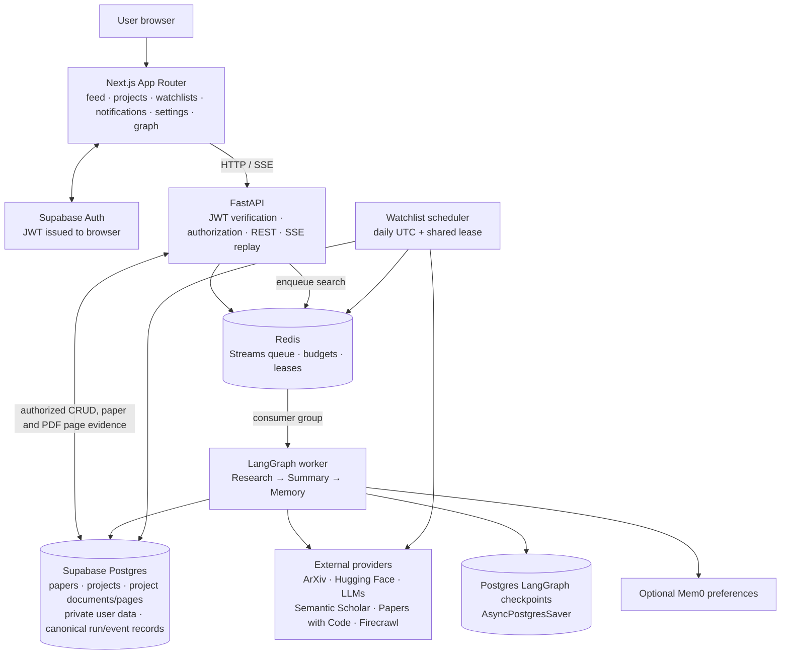

# Zenith — Current Runtime Architecture

> Reviewed against the checked-in code on 2026-11-13. This describes the implemented runtime; the product plan and deployment state remain separate. Production readiness gaps are tracked in `docs/STATUS.md`.

---

## 1. System Context

Zenith is a research paper discovery and organization app. The current UI provides a paper feed, saved papers, settings and account privacy controls, citation graph, project workspaces, topic watchlists, notifications, and streamed search. FastAPI validates user JWTs and owns server-side data access. Search requests enter a Redis Streams worker queue; the worker runs the LangGraph Research → Summary → Memory pipeline. The pipeline uses ArXiv, Hugging Face, configured LLM providers, Supabase, and optional Mem0. Separate endpoints provide project-scoped extractive evidence maps, answers, and comparisons. A Redis-leased scheduler triggers watchlist ingestion and creates caller-scoped in-app notifications.

**Current limitation:** project `/api/research/answer` and `/api/research/evidence-map` return exact abstract and extracted PDF page sentences selected by keyword overlap. The separate `/api/research/synthesize` endpoint is disabled by default through `RESEARCH_SYNTHESIS_ENABLED`; when enabled, it drafts up to five provisional claims from at most six exact abstract sentences, then asks a second provider call to review evidence relations. An authenticated `/api/research/capabilities` response controls whether the UI exposes that mode, while the API independently enforces the flag. It returns server-validated citations and model-reviewed status labels, not independently verified scientific conclusions; private PDFs are excluded. Non-project answers, general retrieval, and comparison dimensions remain abstract/metadata based. See `docs/STATUS.md` for release blockers.

`POST /api/research/plan` is a provider-free, deterministic preview. It classifies intent, returns a fixed task template and bounded suggested limits, and authorizes project scope before responding. It does not read sources or execute a plan; its limits do not constrain separate research API requests. Dollar spend is not measured.

---

## 2. High-Level Architecture



Production run metadata, results, ordered events, and LangGraph graph state are stored in Postgres. The run store uses Supabase service-role RPCs; the graph checkpointer uses `AsyncPostgresSaver` with `DATABASE_URL`. Redis carries queued work and short-lived worker leases. Development may omit `DATABASE_URL` and use process memory; production startup fails closed if Postgres graph checkpointing is unavailable. On worker recovery, the graph resumes from its last completed node checkpoint; a failure inside a node may repeat that node's external calls.

Project PDF uploads are parsed in FastAPI with bounded pypdf extraction. The original bytes are discarded; extracted page text is stored in project-scoped `project_documents` and `project_document_pages` tables under RLS (migration 0013). Owners/editors can upload; accessible project members can list and read pages. Project evidence-map and answer routes consider up to 10 uploaded documents/500 page rows alongside attached paper abstracts and return at most five exact spans with page-local offsets and stable `document_id:page:N` citation IDs. General search and comparison do not search PDF pages. OCR is not implemented.

---

## 3. Layer Details

### Layer 1 — Next.js Frontend

| Concern | Decision |
|---------|----------|
| Framework | Next.js 15 (App Router) |
| Language | TypeScript |
| Styling | Tailwind CSS |
| 3D Graphics | Three.js / React Three Fiber |
| State | React Query (server) + Zustand (client) |
| Auth UI | Supabase Auth (email/password + OAuth) |

**Pages:**
- `/` — Landing / marketing page
- `/feed` — Personalised paper feed with search, SSE progress, model selector, save/dismiss
- `/graph` — 3-D citation network (force-directed graph)
- `/paper/[id]` — Paper detail with AI summary, contributions, difficulty, code repos
- `/login` — Supabase Auth UI
- `/projects` and `/projects/[id]` — Project list and role-aware project workspace
- `/watchlists` and `/notifications` — Topic watch configuration and in-app notification management
- `/settings` — User preferences, authenticated account export, and typed-confirmation deletion

**Key Components:**
- `PaperCard` — Title, authors, AI TL;DR, relevance score, save/dismiss actions
- `CitationGraph` — Force-directed Three.js graph; nodes=papers, edges=citations; click to navigate
- `StreamingResponse` — SSE consumer with replay event deduplication and cancel control
- `ModelSelector` — Model list loaded from `/api/models`
- `SkeletonCard` — Loading placeholder with shimmer animation
- `Navbar` / `Footer` — Shared layout components
- `EmptyState` — Empty state placeholder for no-results states
- `ErrorBoundary` — React error boundary for graceful failure handling
- `QueryProvider` — TanStack Query provider wrapping the app

The supported model IDs are served by the backend registry; inspect `backend/services/llm_router.py` and `GET /api/models` for the current list.

---

### Layer 2 — FastAPI Backend

| Concern | Decision |
|---------|----------|
| Framework | FastAPI |
| Runtime | Python 3.12, Uvicorn |
| Streaming | Server-Sent Events (sse-starlette) |
| Auth | Supabase JWT validation (ES256 JWKS, HS256 legacy fallback) |
| Rate Limiting | slowapi with Redis storage; production requires Redis and disables in-memory fallback |
| CORS | Explicit configured origins, methods, and headers |
| Logging | Structured logging with timestamps and module names |
| Observability | Langfuse tracing (LangGraph) + Sentry error tracking |

**Current route groups (see FastAPI OpenAPI for full request schemas):**
```
GET    /api/health                         # Liveness
GET    /api/ready                          # Dependency reachability (Supabase + Redis)
POST   /api/auth/token                     # Validate Supabase JWT
GET    /api/papers, /api/papers/saved      # Feed and saved papers
GET    /api/papers/{id}, /api/papers/{id}/code
POST   /api/papers/{id}/save                # Save/dismiss
DELETE /api/papers/{id}/save
POST   /api/search                          # Authenticated, idempotent run creation
POST   /api/stream/session                  # Exchange bearer JWT for short-lived SSE token
GET    /api/stream/{run_id}?token=...       # Read-only SSE replay/subscription
GET    /api/runs/{id}, /events              # Status and replayable events
POST   /api/runs/{id}/cancel
POST   /api/retrieval/search                # Hybrid search; optional project scope
POST   /api/research/plan|compare|answer    # Plan, heuristic comparison, abstract-only answer
POST   /api/research/evidence-map           # Project abstracts + extracted PDF page spans
GET/POST/PATCH/DELETE /api/projects/...     # Projects, members, email invitations, notes, papers and PDF documents/pages
GET/POST/PATCH/DELETE /api/watchlists/...   # Watchlists
GET    /api/notifications                   # In-app notifications
POST   /api/notifications/read              # Mark all caller notifications read
POST   /api/notifications/{id}/read         # Mark one caller notification read
GET    /api/models                          # Supported model registry
GET    /api/graph/{paper_id}                # Authenticated citation graph
GET    /api/implementations/{paper_id}/plan|export
POST   /api/implementations/{paper_id}/run # Currently returns not-attempted
GET    /api/account/export; DELETE /api/account
POST   /api/internal/ingest                 # Admin-key protected ingestion trigger
```

**Rate Limits** (slowapi global limits use Redis in production; `/api/search` also has a per-user daily budget):
| Endpoint | Limit |
|----------|-------|
| `/api/search` | 10 req / minute |
| `/api/stream/*` | 20 req / minute |
| `/api/health` | Exempt (unlimited) |
| All other endpoints | 60 req / minute (default) |

**Middleware Stack:**
1. `CORSMiddleware` — Allows configured frontend origins and explicit methods/headers
2. `SlowAPIMiddleware` — Rate limiting via slowapi (Redis required in production)
3. `TimingMiddleware` — Adds `X-Response-Time` header
4. Auth middleware — Decodes and validates Supabase JWT (ES256 via JWKS, HS256 legacy fallback), attaches `request.state.user`
5. Rate limit exception handler — Returns 429 JSON response

**SSE Events:**
- `agent_step` — Live progress from each agent (research, summary, memory, orchestrator)
- `result` — Final ranked paper list with `PaperSearchResult` schema
- `error` — Pipeline failure
- `cancelled` — Run was cancelled; late provider results are suppressed
- Every stored event has a monotonically increasing per-run sequence used for replay deduplication.

---

### Layer 3 — LangGraph Orchestration

**Graph Topology:**
```
START
  └─► Research Agent ──► ArXiv API + HuggingFace Daily Papers
         │                    (deduplication by paper ID)
         ▼
      Summary Agent   ──► LLM (via OpenRouter, with retry + exponential backoff)
         │                    (generates TL;DR, contributions, difficulty)
         ▼
      Memory Agent    ──► Mem0 profile + embedding similarity ranking
         │                    (keyword fallback if no Mem0 profile)
         ▼
        END
```

The graph is compiled with `langgraph.graph.StateGraph` and uses a typed `OrchestratorState` TypedDict.

**Agents:**

- **Orchestrator** (`agents/orchestrator.py`) — Initialises the state graph, invokes agents sequentially, streams all collected steps, and returns `PaperSearchResult`. Updates the run store on completion.

- **Research Agent** (`agents/research_agent.py`) — Discovers papers via ArXiv API (`arxiv` Python lib) and HuggingFace Daily Papers API (`httpx`). Deduplicates by paper ID. Uses async retry with exponential backoff for all API calls. Emits SSE steps for `fetching_arxiv`, `arxiv_fetched`, `fetching_huggingface`, `huggingface_fetched`, and `deduplication_complete`.

- **Summary Agent** (`agents/summary_agent.py`) — Generates AI summaries using the configured LLM. Reads its system prompt from `agents/prompts/summary_prompt.txt`. Wraps paper content in `<paper_content>` delimiters and instructs the model to treat it as untrusted data (prompt-injection guard). Handles JSON extraction from LLM responses (supports direct JSON, markdown fences, and partial JSON). Uses `async_retry` for LLM calls (transient API/rate-limit errors). Caps per-request LLM fan-out to `MAX_SUMMARIES_PER_RUN` (default 20); overflow papers get an abstract-preview fallback with no LLM call. Graceful degradation: returns truncated abstract as fallback on failure.

- **Memory Agent** (`agents/memory_agent.py`) — Loads user profile from Mem0, computes relevance scores using embedding similarity (cosine similarity on `text-embedding-3-small` vectors). Falls back to keyword overlap matching when no Mem0 profile exists. Returns papers sorted by relevance score descending.

---

### Layer 4 — External Integrations

| Service | Role | Integration | Auth | Retry |
|---------|------|-------------|------|-------|
| **ArXiv API** | Paper discovery | `arxiv` Python lib (sync, run in executor) | No | Yes (3 retries, exp backoff) |
| **HuggingFace Daily Papers** | Curated highlights | REST API (`httpx`) | No | Yes (3 retries) |
| **OpenRouter** | Primary LLM gateway | OpenAI-compatible endpoint (`langchain-openai`) | API key | Yes (transient errors at call site) |
| **Anthropic (direct)** | Claude fallback | `langchain-anthropic` | API key | Yes (transient errors at call site) |
| **OpenAI (direct)** | GPT fallback + embeddings | `langchain-openai` + direct `httpx` for embeddings | API key | Yes (transient errors at call site) |
| **Google Gemini (direct)** | Gemini fallback | `langchain-google-genai` | API key | Yes (transient errors at call site) |
| **Mistral (direct)** | Mistral fallback | `langchain-mistralai` | API key | Yes (transient errors at call site) |
| **Firecrawl** | Full paper crawl | `firecrawl-py` SDK | API key | No (cached in Supabase, keyed by paper ID) |
| **Mem0** | User memory | `mem0` Python client | API key | No |
| **Supabase** | Auth + vector DB + relational data | `supabase-py` async client | Service role key | No |
| **Semantic Scholar** | Citation graph | S2 REST API (`httpx`) | Optional API key | Yes (3 retries), edges cached in Supabase |
| **Papers With Code** | GitHub repos for papers | PWC REST API (`httpx`) | No | No (silent degradation) |
| **Redis** | Streams queue, worker leases, global rate limits, per-user budgets, scheduler leases | `redis.asyncio` (required for production) | `REDIS_URL` | Pending-entry reclaim; bounded readiness check |

Retry is kept separate from the provider fallback chain: `async_retry` handles
same-provider transient failures (connect/read timeouts, 5xx, rate limits on
any of the LLM/embedding SDKs), while `llm_router` handles provider swapping.
`services/retry.py` matches transient errors by exception class (builtin +
`httpx` errors, plus vendor SDK names such as `APIConnectionError`,
`RateLimitError`, `InternalServerError`).

---

## 4. Data Flow

### Paper Ingestion Flow
```
1. The backend scheduler polls for the daily 02:00 UTC ingestion window when
   Supabase and Redis are configured. Fly cron and admin manual triggers call
   the same leased runner; only one ingestion job may hold the shared lease.
2. Research fetches ArXiv + HF APIs (with async retry)
3. New papers are deduplicated by paper ID (cross-source)
4. Summary Agent generates TL;DR, key contributions, and difficulty via LLM
   (capped at MAX_SUMMARIES_PER_RUN per run)
5. Embedding pipeline stores vectors in Supabase (text-embedding-3-small, 1536-dim)
6. Memory Agent scores papers against user profile (embedding similarity or keyword fallback)
7. Orchestrator merges and ranks; results stream to frontend via SSE
```

### User Interaction Flow
```
1. User visits /feed
2. Frontend requests GET /api/papers (JWT attached via Authorization header)
3. Backend fetches ranked papers from Supabase user_papers + Mem0 profile
4. User enters a search query and clicks "Search"
5. Frontend POSTs to `/api/search` with bearer JWT and optional `Idempotency-Key`;
   backend writes run state and enqueues work
6. A worker consumes the Redis Stream entry under a consumer group and lease
7. Frontend exchanges its JWT at `/api/stream/session` and subscribes to
   `/api/stream/{run_id}?token=...`; SSE only replays/subscribes and never starts work
8. Frontend deduplicates replayed event IDs, can cancel via `/api/runs/{id}/cancel`,
   and renders the final result
```

### Agent Pipeline Flow (with retry)
```
POST /api/search (JWT, optional Idempotency-Key)
  ├─► Creates canonical run record in PostgresRunStore in production (Redis or memory in development)
  ├─► Appends run_id to Redis Stream and returns run_id
  ├─► Worker consumer-group claims entry; per-run lease prevents double execution
  ├─► research_node → ArXiv + HF → deduplicate
  ├─► summary_node  → LLM through llm_router (bounded fan-out)
  ├─► memory_node   → Mem0 profile/ranking
  ├─► Persists sequenced events to the run store for replay
  └─► Acknowledges job after terminal completion; idle pending jobs can be reclaimed

GET /api/stream/session (JWT exchange) → short-lived stateless signed token
GET /api/stream/{run_id}?token=...
  ├─► Verifies token and run ownership
  ├─► Replays stored events, then subscribes to new events (read-only)
  └─► Cancellation suppresses late result publication
```

---

## 5. Data Model

### Supabase Schema

```sql
-- Papers table with vector search
CREATE TABLE papers (
  id           TEXT PRIMARY KEY,
  title        TEXT NOT NULL,
  abstract     TEXT,
  authors      JSONB DEFAULT '[]',
  url          TEXT,
  published_at TIMESTAMPTZ,
  summary_tldr TEXT,
  embedding    VECTOR(1536),
  created_at   TIMESTAMPTZ DEFAULT NOW()
);

CREATE INDEX ON papers USING ivfflat (embedding vector_cosine_ops);
CREATE INDEX ON papers (published_at DESC);

-- User saved papers
CREATE TABLE user_papers (
  user_id    UUID REFERENCES auth.users(id) ON DELETE CASCADE,
  paper_id   TEXT REFERENCES papers(id) ON DELETE CASCADE,
  saved_at   TIMESTAMPTZ DEFAULT NOW(),
  dismissed  BOOLEAN DEFAULT FALSE,
  PRIMARY KEY (user_id, paper_id)
);

-- User preferences (LLM model, research interests)
CREATE TABLE user_prefs (
  user_id          UUID PRIMARY KEY REFERENCES auth.users(id) ON DELETE CASCADE,
  preferred_model  TEXT DEFAULT 'anthropic/claude-sonnet-4-5',
  interests        TEXT[] DEFAULT '{}',
  updated_at       TIMESTAMPTZ DEFAULT NOW()
);

-- Vector similarity search function
CREATE FUNCTION match_papers(
  query_embedding VECTOR(1536),
  match_threshold FLOAT,
  match_count INT
) RETURNS TABLE(...) LANGUAGE SQL STABLE;

-- Citation graph edges, cached from Semantic Scholar (backing table for
-- GET /api/graph/{paper_id}; avoids hammering the rate-limited S2 API)
CREATE TABLE citations (
  paper_id    TEXT REFERENCES papers(id) ON DELETE CASCADE,
  root_title  TEXT,
  cited_id    TEXT,
  cited_title TEXT,
  fetched_at  TIMESTAMPTZ DEFAULT NOW(),
  PRIMARY KEY (paper_id, cited_id)
);

-- Firecrawl full-text crawl cache, keyed by paper ID
CREATE TABLE crawled_content (
  paper_id   TEXT PRIMARY KEY REFERENCES papers(id) ON DELETE CASCADE,
  url        TEXT,
  content    TEXT,
  fetched_at TIMESTAMPTZ DEFAULT NOW()
);

-- Compound index for the personalised feed query
CREATE INDEX idx_user_papers_feed ON user_papers (user_id, dismissed, saved_at DESC);
```

### Mem0 Memory Model

Mem0 stores user preferences as natural-language memories:
- "Alice is interested in diffusion models"
- "Bob dislikes papers without code"
- "Saved paper: Attention Is All You Need — a survey of transformer variants"

Memories are auto-consolidated and deduplicated by Mem0 over time.

---

## 6. LLM Routing Strategy

All LLM calls flow through `services/llm_router.py`.

**Primary path:** OpenRouter (single API key, unified OpenAI-compatible interface). Identified by the presence of `/` in the model name (e.g. `anthropic/claude-sonnet-4-5`).

**Fallback chain:** When OpenRouter is unavailable (API key missing or runtime error):
1. `claude-*` models → Anthropic direct SDK
2. `gpt-*` models → OpenAI direct SDK
3. `gemini-*` models → Google Gemini direct SDK
4. `mistral-*` models → Mistral direct SDK
5. Everything else → OpenAI direct (as final fallback)

**Agent model map:**
| Agent | Default Model | Reason |
|-------|--------------|--------|
| Orchestrator | `anthropic/claude-opus-4` | Best reasoning |
| Research | `openai/gpt-4o-mini` | Fast tool calls |
| Summary (default) | `anthropic/claude-sonnet-4-5` | Long context + quality |
| Summary (fast) | `google/gemini-2.0-flash` | Batch summarisation |
| Memory | `openai/gpt-4o-mini` | Lightweight scoring |

**Cost guardrails:**
- `max_tokens=4096` on all LLM calls (or `max_output_tokens` for Gemini)
- Cache embeddings and summaries in Supabase to avoid re-processing
- Use fast/cheap models for pre-filtering (relevance scoring) before expensive models
- `MAX_SUMMARIES_PER_RUN` (default 20) caps per-request LLM fan-out; a search
  returning 30-50 papers only gets the top-N summarised by the LLM, the rest
  receive an abstract-preview fallback with no LLM call

**User override:** The `ModelSelector` component on the frontend lets users choose their preferred model. This is sent as `model` in `POST /api/search` and passed through the orchestrator to the summary agent.

---

## 7. Memory & Personalisation

### Mem0 (User Memory)

Stores high-level user preferences as natural-language memories. The Memory Agent reads the user's Mem0 profile and uses it to score and re-rank papers. New signals (saves, dismissals) are written back to Mem0 after each user action.

### Supabase pgvector

Stores paper embeddings (1536-dim from `text-embedding-3-small`). Enables:
- Semantic search via `match_papers()` PostgreSQL function
- Duplicate detection before inserting new papers
- Related-papers panel on the paper detail page

### Embedding Pipeline

```
Raw paper text (title + abstract)
    └─► OpenAI text-embedding-3-small API (httpx)
          └─► Supabase upsert (papers.embedding column)
```

### Memory Agent Scoring

1. **Embedding-based (primary):** When Mem0 has user memories, the agent embeds the user's interest text and each paper abstract. Relevance is computed as cosine similarity between the interest vector and each paper vector.
2. **Keyword-based (fallback):** When no Mem0 profile exists, the agent extracts keywords from the search query and matches against paper title/abstract keywords. Score = matches / query keyword count.
3. **Default (last resort):** If neither method works, all papers get a score of 0.5.

---

## 8. Run State Management

`services/run_store.py` offers a process-local `RunStore` for development, `RedisRunStore` when Redis is configured outside production, and `PostgresRunStore` in production. Production requires reachable Supabase and Redis and fails closed if the `research_runs` / `run_events` schema or RPCs are missing. Postgres stores canonical run state/events; Redis provides Streams delivery and tokenized leases. Event sequence allocation and status changes are atomic Postgres RPCs; terminal cancellation cannot be overwritten by late completion.

**Durability boundary:** queue delivery is recoverable through Redis pending-entry reclaim, while graph state is checkpointed in Postgres after each node. The worker checks the thread state and resumes pending nodes; a crash during a node can repeat that node, so external calls must remain retry-safe. Production requires `DATABASE_URL` and the `langgraph-checkpoint-postgres` package. App startup runs the checkpointer's additive, idempotent schema setup and fails closed on errors. Checkpoint decoding uses strict msgpack deserialization. Development uses `MemorySaver` only when `DATABASE_URL` is omitted. Staging must verify restart recovery, replay, cancellation, retention, and migration/restore behavior before production.

---

## 9. Retry Mechanism

The `services/retry.py` module provides `async_retry(func, max_retries=3, base_delay=1.0)`, an async retry wrapper with exponential backoff.

**Used by:**
- `services/arxiv.py` — ArXiv API calls (3 retries)
- `services/huggingface.py` — HuggingFace Daily Papers API (3 retries)
- `services/semantic_scholar.py` — Semantic Scholar API (3 retries)
- `agents/summary_agent.py` — LLM calls per paper (3 retries, on any OpenRouter or direct-provider SDK)
- `services/embeddings.py` — OpenAI embedding calls (3 retries)
- `services/ingestion.py` — Supabase upserts during daily fetch (3 retries)

**Backoff schedule:** 1s → 2s → 4s (base_delay * 2^attempt)

**Transient errors:** `async_retry` retries builtin `ConnectionError`/`TimeoutError`,
any `httpx.HTTPError` (connect/read timeouts, 5xx), and vendor LLM SDK errors
matched by class name (`APIConnectionError`, `RateLimitError`,
`InternalServerError`, `ServiceUnavailable`, `Unavailable`, etc.). Non-transient
errors (validation, JSON parse) are re-raised immediately. Retry is orthogonal
to the provider fallback chain in `llm_router.py` — retry handles the same
provider's transient failure, fallback handles provider unavailability.

---

## 10. Auth & Security

**Supabase Auth:**
- Email/password + OAuth (Google, GitHub)
- JWT returned to frontend after sign-in
- Frontend attaches `Authorization: Bearer <token>` on every API call
- FastAPI middleware validates the JWT in `services/jwt_validator.py`:
  - Since October 2025 new Supabase projects sign JWTs **asymmetrically (ES256)**
    with the public key published on `{SUPABASE_URL}/auth/v1/.well-known/jwks.json`.
    The validator fetches and caches the JWKS (1-hour TTL), selects the key by the
    token's `kid` header, and verifies with ES256.
  - Legacy projects that still sign with the shared secret are verified with
    HS256 against `SUPABASE_JWT_SECRET` (fallback only for HS256-tagged tokens).
- `user_id` from JWT used as Mem0 key and for filtering saved papers

**Rate Limiting:**
- `POST /api/search`: 10 req/min
- `GET /api/stream/*`: 20 req/min
- `GET /api/health`: exempt
- Default: 60 req/min for all other endpoints
- slowapi's limiter is backed by Redis (`storage_uri` = `REDIS_URL`) so limits
  are global across backend instances. Production requires Redis and disables
  in-memory fallback; development may use memory.

**CORS:**
- Allowed origins come from the backend-only comma-separated `CORS_ORIGINS`; when unset, the single `APP_URL` origin is used.
- `APP_URL` remains one canonical URL and is also sent as OpenRouter's `HTTP-Referer`.
- Credentials enabled; methods and headers use explicit allowlists in `main.py`.

---

## 11. Folder Structure

```
Zenith/
├── frontend/                 # Next.js App Router, components, API client, tests
├── backend/
│   ├── routers/               # HTTP routes and request handling
│   ├── services/              # Supabase, Redis, providers, retrieval, budgets
│   ├── agents/                # LangGraph nodes and separate prompt files
│   ├── security/              # Authorization and validation
│   ├── guardrails/            # Tool and action policy
│   ├── scripts/               # Daily ingestion and maintenance commands
│   └── tests/                 # API, security, service, and graph tests
├── supabase/migrations/       # Ordered schema changes; schema.sql is a snapshot
├── evals/                     # Versioned local cases and smoke runner
├── docs/                      # API, security, operations, status, audit records
└── .github/workflows/         # Push/PR CI and manual ingestion trigger
```

---

## 12. Deployment

| Component | Primary Platform | Alternative |
|-----------|-----------------|-------------|
| Frontend | Vercel | Docker, any Node.js host |
| Backend | Fly.io | Railway, Docker on cloud VM |
| Database | Supabase (managed Postgres) | Self-hosted Postgres |
| Redis | Managed Redis required in production / local Redis for development | In-memory is development-only |
| Daily ingestion scheduler | Backend 02:00 UTC poller, coordinated by a shared Redis lease | Fly cron/manual admin triggers use the same guarded runner |
| CI/CD | GitHub Actions on push, pull request, and manual dispatch | Run lint/test/build locally |

Docker Compose files are available for both local development (`docker-compose.yml`) and single-server production deployment (`docker-compose.prod.yml`).

See **[docs/DEPLOYMENT.md](./docs/DEPLOYMENT.md)** for step-by-step deployment instructions.

---

## 13. Environment Variables

See `.env.example` for the full list. Key categories:
- **LLM Providers:** `OPENROUTER_API_KEY` (required), `ANTHROPIC_API_KEY`, `OPENAI_API_KEY`, `GOOGLE_API_KEY`, `MISTRAL_API_KEY`
- **Data Sources:** `FIRECRAWL_API_KEY`, `SEMANTIC_SCHOLAR_API_KEY`
- **Memory & Storage:** `MEM0_API_KEY`, `SUPABASE_URL`, `SUPABASE_ANON_KEY`, `SUPABASE_SERVICE_ROLE_KEY`, `SUPABASE_JWT_SECRET` (HS256 legacy fallback only)
- **Scheduler:** `ADMIN_API_KEY` (authenticates `/api/internal/ingest`)
- **Cost guardrails:** `MAX_SUMMARIES_PER_RUN`
- **Observability:** `LANGFUSE_PUBLIC_KEY`, `LANGFUSE_SECRET_KEY`, `LANGFUSE_HOST`, `SENTRY_DSN`, `SENTRY_TRACES_SAMPLE_RATE`, `APP_ENV`
- **App:** `APP_URL` (canonical frontend URL / LLM referer), `CORS_ORIGINS` (comma-separated exact frontend origins), `NEXT_PUBLIC_API_URL`, `REDIS_URL` (queue, budgets, and leases); `DATABASE_URL` (required in production for durable graph checkpoints)
