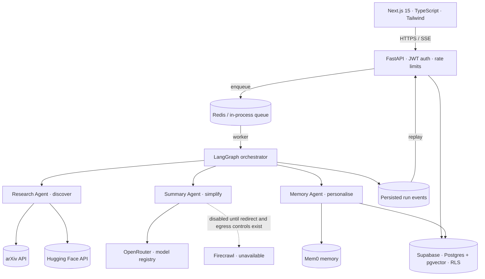
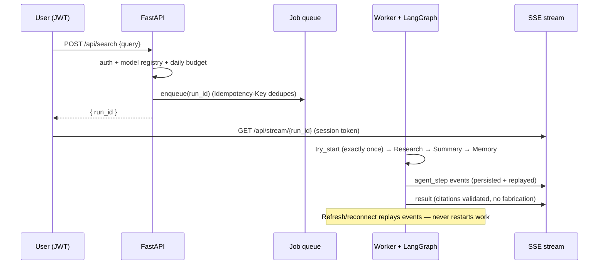

<div align="center">


### A research workspace for finding, understanding, and tracking papers

[](https://github.com/mahirmlk/Zenith/actions/workflows/ci.yml)
[](backend/pyproject.toml)
[](frontend/package.json)
[](backend/main.py)
[](backend/pyproject.toml)
[](supabase/migrations/)
[](LICENSE)

[Capabilities](#capabilities) · [How it works](#how-it-works) · [Agents](#agent-workflow) · [Evaluation](#evaluation-and-validation) · [Architecture](#architecture) · [Quick start](#quick-start) · [API](#api) · [Security](#security) · [Roadmap](#roadmap)

</div>

## Overview

Zenith brings paper discovery, evidence-backed reading, and research organization into one workspace. It searches arXiv and Hugging Face Daily Papers, summarizes abstracts, builds citation graphs, and ranks results against a user profile. Projects add notes, shared access, PDF page evidence, and cited research answers.

**Release status: not production-ready.** The figures below are local regression results from small, hand-authored datasets, not a broad research-quality benchmark. Staging migrations and tenant isolation, live provider behavior, recovery and restore exercises, monitoring, deployment, and current-head remote CI remain unverified.

## Capabilities

| Area | What it does |
|---|---|
| Paper discovery | Fetches arXiv search results and Hugging Face Daily Papers concurrently, then deduplicates by paper ID. |
| Hybrid retrieval | Combines lexical BM25 and vector retrieval, with project membership applied to scoped queries. |
| Personal ranking | Uses a Mem0 profile with pgvector or embedding similarity. Without profile interests, it uses query-keyword overlap; if profile embeddings fail, it assigns a neutral fallback score. Scores are relative ranking signals. |
| Paper summaries | Generates structured TL;DR, contributions, and difficulty where available. Summary provenance distinguishes generated content from abstract previews and fallbacks. |
| Citation graph | Uses cached Semantic Scholar citation edges with deterministic graph layout. |
| Durable research runs | Streams agent progress with SSE and persists events for replay after reconnect. Idempotency keys prevent duplicate run creation; owners can inspect and cancel runs. |
| Shared projects | Organizes papers, notes, and uploaded PDFs with owner/editor/viewer roles, invitations, and soft deletion. |
| Page-level evidence | Retrieves exact PDF page spans with offsets and provenance, filters instruction-like source text, and returns citations that can be checked against the source. |
| Cross-paper research | Provides evidence maps, answers, and heuristic comparisons. Paper rows use abstracts; project PDFs appear as separately cited document evidence. Optional synthesis is provisional and disabled by default. |
| Paper-to-code planning | Extracts facts from exact abstract spans, flags missing reproduction details, and exports a Markdown plan. Suggested repositories are unverified; arbitrary code execution is disabled. |
| Research planning | Shows a bounded plan preview. A separate queued executor exists behind a disabled-by-default feature flag and still needs staging validation. |
| Change monitoring | Supports topic, author, citation, DOI-backed Crossref status watches, and observed changes in verified results on official Hugging Face benchmark leaderboards. Alerts are in-app; email digests are opt-in and gated. |
| Cost and safety controls | Applies per-user daily budgets, provider spend metering, bounded model fan-out, rate limits, citation checks, disables uncontrolled user-URL fetching, and requires explicit approvals for higher-risk actions. |

### What sets Zenith apart

| Evidence you can inspect | Work that survives reconnects | Bounded automation | Personal research context |
|---|---|---|---|
| Answers point back to paper sentences or PDF pages. Missing details are surfaced as gaps instead of filled in from a model summary. | Search steps and run events are persisted for replay. Production uses Postgres graph checkpoints and Redis-backed queueing and leases. | Plan execution, synthesis, and email delivery are independently gated. Paper-code execution is always refused by the current runner. | Research projects bring papers, notes, shared roles, uploaded PDFs, saved items, and watchlists together. Memory-based ranking is personalized but is not presented as a probability. |

The implementation is present locally, but live database policies, provider behavior, and recovery paths still need staging verification. See [release status](docs/STATUS.md).

### How it works

1. **Ask a research question.** The API authenticates the user, checks rate and spend budgets, and creates an idempotent run.
2. **Discover and enrich papers.** The worker searches arXiv and Hugging Face, deduplicates results, requests bounded summaries through the model router, and records progress.
3. **Rank for the researcher.** The memory step scores papers against saved profile interests. If there is no profile, it ranks by query-keyword overlap; if profile embedding calls fail, the current fallback assigns neutral scores rather than inventing a personalized ranking.
4. **Continue with evidence.** Save papers into a project, retrieve cited abstract or PDF-page evidence, compare sources, and optionally enable gated research workflows after deployment review.

### Reading papers and project evidence

Zenith keeps the source type visible because an abstract, a retrieved PDF page, and a model-written summary have different evidential weight:

- **Public paper search and comparison rows are abstract-based.** A generated summary is a reading aid, not a substitute source. The interface records whether a summary was generated or rendered as an abstract preview.
- **Uploaded project PDFs are indexed as page-level documents.** Retrieval returns the document and page, an exact text span, and offsets within that page. The evidence selector filters instruction-like source text and abstains when no supported span matches.
- **PDFs stay separate from papers.** The current schema does not claim that an uploaded document is an official copy of an attached paper. Project comparison can show document evidence beside paper findings, but it does not silently attribute a PDF to a paper.
- **Answers are extractive where the evaluation gate applies.** The current exact-support metric checks emitted claim text against sentences in the cited abstract or page. Cross-paper synthesis is a separate model-backed feature, is disabled by default, and labels claim relations as provisional.

Project access is enforced in the backend. Owners manage membership; editors can add and manage project material; viewers get read-only access. Invitation acceptance is tied to the recipient's verified email. The frontend does not connect directly to the database.

### Monitoring and research continuity

Watchlists can track topics, authors, inbound citations, DOI-backed update notices from Crossref, and verified results on public official Hugging Face benchmark leaderboards. The first successful benchmark poll seeds a baseline; later alerts describe changes observed by Zenith and cover only the top 100 verified entries. Hugging Face does not supply a change timestamp in this response, and its verification label does not establish scientific validity. Topic ingestion can create in-app notifications; author and citation watches use Semantic Scholar where provider records are available. Crossref notice metadata can be incomplete, so an empty result is not proof that a paper has never changed. Email digests have separate consent, unsubscribe, suppression, and delivery controls and remain gated pending staging verification.

Search runs and their events can be inspected and replayed after an SSE reconnect. An idempotency key prevents an accidental repeat submission from creating a duplicate run. In production, Redis carries jobs and worker leases; Postgres stores canonical run data and LangGraph checkpoints. Checkpoints allow a worker to resume pending graph work, though an external request made inside a graph node can be repeated if the process crashes before that node completes.

### Privacy, export, and deletion

The account API provides an export and an accepted receipt for deletion. Deletion work is persisted and resumed by a leased worker, and account removal from Auth is performed after other cleanup steps. The export has explicit coverage limits: it includes public metadata for saved and project-source paper IDs, while private PDF page data remains caller-scoped. Local failure-injection and authorization tests do not prove that every external service has been cleaned up; cross-service completion still needs staging verification.

### Bounded work and local ceilings

These are implementation ceilings and defaults, not throughput benchmarks. Some are configurable; deployment behavior has not been verified in staging.

| Workload | Current bound or default | Purpose |
|---|---:|---|
| Searches per user | 100 per day by default | Limits daily search admission; configure with `MAX_SEARCHES_PER_DAY_PER_USER`. |
| arXiv discovery | Up to 20 results per query | Bounds the arXiv fetch inside the research agent. Hugging Face Daily Papers are fetched in parallel and deduplicated with arXiv by ID. |
| Summary model fan-out | Up to 20 summaries per run by default; at most 5 concurrent calls | Caps provider spend and concurrency. Papers over the cap receive an abstract preview instead of an LLM call. |
| PDF upload | Up to 20 MiB and 500 pages | Rejects oversized documents before extracting text. Original PDF bytes are discarded after extraction. |
| Optional OCR | Up to 5 scanned pages; 6 seconds per page and 20 seconds total | Local, opt-in Tesseract path for pages without usable native text. OCR quality and container runtime remain unverified. |
| PDF uploads | 3 per minute | Per-user upload rate limit. |
| Crossref watch polling | Up to 100 watch rows per ingestion, 5 concurrent requests | Bounds the DOI update check. This covers deposited Crossref update relations, not every possible paper change. |
| Plan execution | 10 requests per user per day | Additional limit for the gated queued executor; it also applies source, tool, and time ceilings. |
| Cross-paper synthesis input | At most 6 public abstract sentences | Private project PDF text is excluded; output remains provisional and the feature is off by default. |

The plan preview itself reports proposed ceilings and does not run tools. Those preview values are not an estimate of a guaranteed runtime, result quality, or dollar cost.

### Agent workflow

The main search is a three-step LangGraph pipeline. Each step reports progress to the durable run stream. Planning and paper-to-code tools run separately and are not part of every search.

| Agent / component | Inputs and work | Outputs and fallbacks | Boundaries |
|---|---|---|---|
| Orchestrator | Receives a run ID, query, user ID, and optional model selection; runs the graph in research → summary → memory order. | Emits agent-step events, records failures, resumes pending work from LangGraph checkpoints, and returns ranked papers. | Production requires Postgres checkpointing. Local development can use an in-memory saver. A node's external calls can repeat if a crash happens before its checkpoint. |
| Research agent | Searches arXiv for the query and fetches Hugging Face Daily Papers concurrently. | Merges the records and removes duplicate paper IDs. | arXiv search currently requests up to 20 papers; availability and coverage depend on external providers. |
| Summary agent | Sends paper title and abstract to a model obtained through the shared LLM router. | Validates structured TL;DR, difficulty, and contribution fields; applies an abstract-preview fallback for provider errors, invalid output, spend limits, or per-run overflow. | Default ceiling is 20 model summaries per run and at most 5 concurrent calls. Full text is not implied by an abstract-based summary. |
| Memory agent | Loads the user's Mem0 profile and scores the candidate abstracts. | Uses pgvector similarity when available, embedding similarity as a fallback, and query-keyword matching when there are no profile interests. If profile embedding fails, it assigns a neutral score of 0.5. | Relevance values are relative ranking signals; 0.5 is not a calibrated probability or a personalized result. |
| Research planner | Classifies a request and selects from a bounded set of preview steps. | Returns a provider-free preview and proposed source, tool, time, and model-call ceilings. | A separate executor exists behind a feature flag. The five-case plan evaluation checks preview behavior, not execution. |
| Implementation planner | Reads a paper abstract and optional public GitHub search results. | Extracts exact-span facts, lists reproducibility gaps, and produces a Markdown export. | Repository matches remain unverified; the execution runner always refuses arbitrary code execution. |

## Evaluation and validation

The full deterministic baseline in the project status record is dated **2026-11-15**. It includes grounded QA, PDF evidence, mocked-provider synthesis, research-plan, and watchlist fixtures run against the current code. These are local checks against versioned, hand-authored fixtures: useful regression evidence for specific behaviors, but not measurements of production service quality.

### Deterministic retrieval and evidence metrics

`grounded_qa_v3` runs the production hybrid ranker, extractive answer selector, and citation validator against 18 labeled abstract-grounded cases. The examples cover relevant-source ranking, supported and unsupported questions, exact sentence support, multiple-source findings, conflicting findings, causality wording, numeric results, acronym/entity/benchmark disambiguation, prompt injection, and abstention. `pdf_evidence_v1` runs the production PDF page evidence selector against six page-level cases.

| Metric | `grounded_qa_v3` result | Gate | Meaning |
|---|---:|---:|---|
| Cases passed | 18 / 18 | All cases | Each case must pass its expected retrieval, citation, claim, and abstention checks. |
| Abstention accuracy | 1.000 | 1.000 | The selector abstains when the labeled evidence is insufficient and answers when it is answerable. |
| Citation validity | 1.000 | 1.000 | Share of cases in which every emitted citation ID belongs to the retrieved source set. |
| Exact sentence support | 1.000 | 1.000 | Every emitted extractive claim matches a sentence in its cited abstract. |
| Answerable-case claim coverage | 1.000 | 0.900 | Share of labeled answerable cases that produce at least one cited claim. |
| Recall@5 | 1.000 | 0.900 | Average share of labeled relevant source IDs found in the top five, across cases with relevant labels. |
| MRR@5 | 1.000 | 0.900 | Average reciprocal rank of the first relevant source within the top five. |
| Fabricated-citation negative control | Pass | Must reject | A citation ID absent from the retrieved set is rejected. |

| `pdf_evidence_v1` metric | Result | Gate | Meaning |
|---|---:|---:|---|
| Cases passed | 6 / 6 | All cases | Includes exact citation ordering, multiple matching pages, and abstention cases. |
| Citation accuracy | 1.000 | 1.000 | Share of cases whose citation IDs and ordering exactly match the labeled document/page list. |
| Exact page-span rate | 1.000 | 1.000 | Share of cases where every returned page-local offset selects the exact labeled sentence from its page text. |
| Abstention accuracy | 1.000 | 1.000 | Share of cases where the selector abstains exactly when the fixture expects it to. |
| Forbidden-text safety | 1.000 | 1.000 | Share of cases that do not emit their fixture's forbidden instruction-like text. |

### Contract and workflow evaluation suites

| Dataset | Result | Cases exercise | What a pass does not mean |
|---|---:|---|---|
| `cross_paper_synthesis_v2` | 6 / 6 mocked-provider fixtures (2026-11-15) | Conflicting outcomes, one-source support downgraded to uncertain, fabricated generation anchors, unknown verifier evidence IDs, incomplete assessments, and unsupported verifier claims downgraded to uncertain. | It validates service contracts with canned provider responses. It does not measure live model behavior, evidence-span correctness, or scientific conclusions. |
| `research_plan_v1` | 5 / 5 deterministic fixtures | Task routing, phrase-boundary false positives, source scope, bounded ceilings, feature-gated synthesis steps, and preview-only metadata. | It checks plan preview behavior, not live queue/database execution or successful completion of a research plan. |
| `watchlist_notifications_v1` | 5 labeled fixtures; 4 complete source cases | Topic matching and fixture-based author/citation selection. Incomplete-source cases are excluded from recall denominators. | This is a smoke gate, not a live Semantic Scholar or Crossref quality evaluation. Current per-target results are listed below. |

The watchlist runner requires at least 0.500 precision and recall for each target type with complete labeled sources. Its 2026-11-14 output was:

| Target type | True positives | False positives | Missed labeled important items | Precision | Recall |
|---|---:|---:|---:|---:|---:|
| Topic | 3 | 1 | 0 | 0.750 | 1.000 |
| Author | 1 | 1 | 0 | 0.500 | 1.000 |
| Citation | 1 | 1 | 0 | 0.500 | 1.000 |

One author-provider outage fixture was marked incomplete and excluded from the recall denominator. These scores come from only four complete cases and a small number of labeled items. The 0.500 gate is a smoke threshold, not a human-calibrated product-quality target. Comparison inclusion has separate endpoint and UI test coverage; it is not represented as a numeric research-quality benchmark here.

### Evaluation dataset history

| Date | Dataset | Result | Interpretation |
|---|---|---:|---|
| 2026-11-08 | `grounded_qa_v2` | 12 / 12 cases; recorded metrics 1.000 | Earlier 12-case dataset version. Its figures should not be compared as a controlled before/after experiment with v3 because the cases changed. |
| 2026-11-14 | `grounded_qa_v3` | 18 / 18 cases; all six tracked metrics 1.000 | Abstract-grounded case evaluator re-run on the current working tree. |
| 2026-11-14 | `pdf_evidence_v1` | 6 / 6 cases; all four tracked metrics 1.000 | Page-level case evaluator re-run, including injection-only abstention and multiple-page citations. |
| 2026-11-13 | `cross_paper_synthesis_v2` | 6 / 6 | Mocked service-contract checks, not a model-quality benchmark. |
| 2026-11-14 | `research_plan_v1` | 5 / 5 | Deterministic preview checks, not an execution benchmark. |
| 2026-11-14 | `watchlist_notifications_v1` | Topic 0.750 / 1.000; author 0.500 / 1.000; citation 0.500 / 1.000 (precision / recall) | Fresh local fixture-run output; four complete cases and one incomplete case. |
| 2026-11-15 | `grounded_qa_v3`, `pdf_evidence_v1`, `cross_paper_synthesis_v2`, `research_plan_v1`, and `watchlist_notifications_v1` | 18/18, 6/6, 6/6, 5/5, and 5 cases passed respectively | Full deterministic regression suite; one watchlist source case was incomplete. These fixture scores are not calibrated scientific or live-provider quality measures. |

### Broader local validation snapshot

| Check | Recorded result (2026-11-15) | Coverage / qualification |
|---|---:|---|
| Backend tests | 455 passed, 6 skipped | Full local suite, including async routes and migration, authorization, recovery, deployment-config, and project feature tests; provider credentials were cleared. |
| Frontend tests | 97 tests across 14 files | Component, page, API normalization, invitations, project briefs, and streaming tests. |
| Frontend lint and typecheck | Passed | Local ESLint and TypeScript checks. |
| Backend Ruff and strict mypy | Passed | Repository-wide Ruff and strict mypy across 87 source files. |
| Production frontend build | Passed outside sandbox | Default build generated all 13 pages and standalone traces; `/`, `/feed`, `/projects`, and `/watchlists` returned HTTP 200. Supabase public Auth build values are empty locally, so deployed Auth still needs verification. |
| Remote CI on current local head | Not verified | PR #3 check run #56 failed one backend migration-path test on the remote revision; the local test fix passes, but this worktree revision has no remote result. |
| Current-head Docker build | Not verified | Docker daemon was unavailable in the recorded local validation. |

### Reproducing the evaluation

Run from the repository root with the pinned backend environment:

```bash
uv run --project backend --locked python evals/runners/run_evals.py
uv run --project backend --locked python evals/runners/run_watchlist_evals.py
```

`run_evals.py` prints per-case outcomes, aggregate abstract and PDF metrics, and exits nonzero if a case or threshold fails. The CI gate requires 1.000 abstention accuracy, citation validity, exact sentence support, and each of the four PDF metrics; answerable-case claim coverage, Recall@5, and MRR@5 each require at least 0.900. See [evals/README.md](evals/README.md) and [docs/EVALUATIONS.md](docs/EVALUATIONS.md) for dataset scope and version history.

### How to interpret these numbers

The datasets are small, synthetic, hand-authored, and designed to catch regressions in known edge cases. A perfect score on 18 abstract cases and six PDF cases does not establish generalization to real papers or uploaded documents. These evaluations do **not** measure statistical significance, calibrated confidence, broad scientific correctness, quality on live providers, project-comparison quality, production tenant isolation, latency, or cost. No production user, corpus-volume, spend, or response-latency metrics are reported because the release has not been validated on a production deployment. Exact-sentence matching is suitable for the current extractive selectors; it does not evaluate open-ended generated synthesis. Before making a scientific-quality claim, Zenith still needs larger independently labeled corpora, claim-level evidence-span adjudication, blinded domain-expert review, and tests against deployed providers and staging infrastructure.

See [docs/STATUS.md](docs/STATUS.md) for release blockers and the dated local evidence behind this summary.

## Tech stack

<div align="center">

| Layer | Technologies |
|---|---|
| Frontend |    |
| Backend |    |
| AI |   |
| Data |    |
| Infra |   |

</div>

## Architecture

Four layers. The boundaries are enforced in code.



### Layer responsibilities

| Layer | Responsibilities | Boundary |
|---|---|---|
| Next.js frontend | App Router pages for search, feed, saved papers, projects, paper details, graphs, watchlists, notifications, and account settings. Uses typed API clients and TanStack Query for server state. | Calls the FastAPI service; it does not read Supabase tables directly. |
| FastAPI backend | Authenticates JWTs, validates request and response schemas, checks ownership and project roles, applies rate/spend limits, exposes REST/SSE endpoints, and manages the run lifecycle. | Owns authorization and external-service access. User-supplied model IDs and URLs are validated against server-side policy. |
| LangGraph workers | Run the discovery → summary → memory graph and the separately gated plan-execution workflow. Emit structured agent steps and use checkpoints for resumable work. | Graph nodes call backend services; they do not bypass the model router or service-level spend controls. |
| External providers and storage | arXiv and Hugging Face for discovery; Semantic Scholar and Crossref for graph/watch data; OpenRouter for model routing; optional Mem0; Supabase/Postgres for application data and vectors; Redis for queues, budgets, and leases. Firecrawl is disabled. | Provider access is wrapped by backend services. Production connections, migrations, provider behavior, and recovery still require staging verification. |

### External sources and their limits

| Source | Used for | Interpretation limit |
|---|---|---|
| arXiv | Search results, paper metadata, and abstracts | An abstract is not a replacement for the full paper or its supplements. |
| Hugging Face Daily Papers | A curated daily discovery feed | Feed membership is not a quality rating or endorsement. |
| Semantic Scholar | Citation graph edges and author/inbound-citation watch candidates | Coverage and relation accuracy depend on provider records and have not been quality-calibrated against a live corpus. |
| Crossref | DOI metadata and deposited update/retraction relations | Missing Crossref relations do not prove that a paper has never been updated. |
| GitHub repository search | Candidate repositories for paper-to-code planning | Candidate links are unverified and may not be official or reproducible implementations. |
| OpenRouter and configured model providers | Structured summaries and gated cross-paper synthesis | Model output is validated and evidence-linked where possible, but this does not establish scientific correctness. |
| Firecrawl | Disabled | The application issues no hosted crawl or legacy-cache read until redirect and worker egress controls are enforced. |
| Mem0 (optional) | User research-interest memory | Memory availability affects personalization; fallback ranking remains available. |

### Request flow (search to stream)



## Quick start

Prerequisites: Node 20, Python 3.12, uv 0.12.7, Docker (optional).

```bash
git clone https://github.com/mahirmlk/Zenith.git && cd Zenith
cp .env.example .env            # Docker Compose reads the repository-root .env
cp .env.example backend/.env    # the backend reads .env from its working directory
cp frontend/.env.local.example frontend/.env.local

# Backend
cd backend && uv sync --locked --extra dev && uv run --locked uvicorn main:app --reload --port 8000

# Frontend (new terminal)
cd frontend && npm ci && npm run dev   # http://localhost:3000
```

Full stack with Docker: `docker compose up --build` from the repository root (frontend `:3000`, backend `:8000`, Redis `:6379`). Compose uses the root `.env`; the second copy above is for the manual backend process. Set the Supabase URL, service role key, and frontend public URL/anon key before trying sign-in or database-backed features. The API can start with some integrations unavailable in development, but search, persistence, authentication, or personalization will be incomplete until their services are configured.

### Environment variables

| Variable | Required | Purpose |
|---|---|---|
| `OPENROUTER_API_KEY` | Yes (LLM) | Primary LLM routing |
| `SUPABASE_URL` / `SUPABASE_SERVICE_ROLE_KEY` | Yes | DB + vector store |
| `SUPABASE_JWT_SECRET` | Legacy only | HS256 fallback (new projects use JWKS) |
| `APP_URL` | Yes | One canonical frontend origin; sent as OpenRouter HTTP-Referer |
| `CORS_ORIGINS` | No (defaults to `APP_URL`) | Comma-separated exact browser origins |
| `NEXT_PUBLIC_SUPABASE_URL` / `NEXT_PUBLIC_SUPABASE_ANON_KEY` | Frontend build | Supabase Auth client configuration; required for deployed sign-in |
| `MEM0_API_KEY` | Optional | User research-interest memory |
| `SEMANTIC_SCHOLAR_API_KEY` | Optional | Raises provider quota where applicable for citation and author lookups |
| `GITHUB_TOKEN` | Optional | Raises public GitHub repository-search quota; searches remain public-only |
| `REDIS_URL` | Production | Shared queue, distributed rate limits, budgets, scheduler coordination, and worker leases |
| `DATABASE_URL` | Production | Durable LangGraph Postgres checkpoints; local development may use an in-memory checkpointer |
| `LLM_DAILY_SPEND_CAP_USD_MICROS` / `LLM_MONTHLY_SPEND_CAP_USD_MICROS` | Configure before LLM use | USD-micro spend caps; `0` fails closed and blocks provider spend |
| `MAX_SEARCHES_PER_DAY_PER_USER` | No (default `100`) | Daily search admission cap |
| `MAX_SUMMARIES_PER_RUN` | No (default `20`) | Maximum model-generated paper summaries in one run |
| `RESEARCH_SYNTHESIS_ENABLED` | No (default `false`) | Enables provisional cross-paper synthesis after quality and staging review |
| `RESEARCH_PLAN_EXECUTION_ENABLED` | No (default `false`) | Enables the separately bounded queued research-plan executor |
| `NOTIFICATIONS_EMAIL_ENABLED` | No (default `false`) | Enables configured, consented Resend watchlist digests |
| `OCR_ENABLED` | No (default `false`) | Enables bounded local Tesseract OCR for scanned project PDF pages |
| `ADMIN_API_KEY` | Scheduler | Authenticates `POST /api/internal/ingest` |
| `SANDBOX_ENABLED` | Ignored by current runner | Arbitrary paper-code execution is always refused |

The root [.env.example](.env.example) is the canonical full configuration reference. For the local frontend, copy [frontend/.env.local.example](frontend/.env.local.example) to `frontend/.env.local` and set the Supabase public URL/key. In production, configure Redis and Postgres, set nonzero budgets intentionally, and leave model-backed synthesis, plan execution, and email delivery disabled until their release gates pass. Before production, apply migrations `0001–0030` using the [migration runbook](docs/MIGRATIONS_RUNBOOK.md), then verify RLS, invitations, provider behavior, and rollback/restore in staging.

## API

The backend exposes authenticated JSON APIs plus an SSE channel for long-running search work. Most endpoints require a Supabase user JWT; streaming uses a short-lived run session token. Run and account routes are scoped to the owner, and project-scoped retrieval rechecks the caller's membership. Public health/model discovery routes are intentionally separate from user data.

| Route family | Auth | Purpose and contract |
|---|---|---|
| `POST /api/search` | JWT | Validates a query and selected model, checks daily and spend budgets, deduplicates requests with an idempotency key, then returns a run ID. |
| `GET /api/stream/{run_id}` | Short-lived SSE token | Streams persisted agent-step and result events. Reconnecting replays available events rather than creating another run. |
| `GET /api/runs/{id}`, `/events`, `POST /api/runs/{id}/cancel` | JWT, run owner | Reads run state and event history or requests cancellation. A run is not exposed to an unauthenticated caller. |
| `/api/papers`, `/api/papers/saved`, `/api/papers/{id}`, `/api/papers/{id}/save` | JWT | Reads the paper library and manages a user's saved-paper collection. |
| `GET /api/graph/{id}` | JWT | Returns cached citation-graph data for a paper. |
| `POST /api/retrieval/search` | JWT | Performs hybrid lexical/vector retrieval. Project source scope is validated against membership. |
| `POST /api/research/plan` | JWT | Returns a provider-free research-task preview. |
| `POST /api/research/execute` | JWT; feature flag and budgets | Enqueues a bounded research plan for execution. It is disabled by default and not staging-verified. |
| `POST /api/research/answer`, `/compare`, `/evidence-map`, `/synthesize` | JWT | Returns bounded cited evidence, heuristic comparisons, or provisional cross-paper synthesis. Synthesis is disabled by default. |
| `/api/implementations/{id}/plan`, `/export` | JWT | Produces an abstract-grounded plan and Markdown export; no code is executed. |
| `/api/projects`, `/notes`, `/members`, `/invitations` | JWT and project role | Manages research spaces, notes, source attachments, invitations, and membership under owner/editor/viewer permissions. |
| `/api/watchlists`, `/api/notifications` | JWT | Manages personal monitoring targets and in-app notifications. Email delivery is a separate opt-in path. |
| `GET /api/account/export`, `DELETE /api/account` | JWT | Exports available caller-scoped data or starts durable deletion. Export coverage and external-service deletion limits are documented. |
| `GET /api/models` | Public | Lists the server model registry and availability; callers cannot provide arbitrary provider model IDs. |
| `GET /api/health`, `/api/ready` | Public | Reports process liveness and bounded readiness checks. |

Full contracts: [docs/API.md](docs/API.md).

## Project structure

```
Zenith/
├── frontend/          Next.js 15 (App Router) · app/ · components/ · lib/
├── backend/
│   ├── agents/        LangGraph orchestration, discovery, summaries, ranking, and planning
│   ├── routers/       papers · search · stream · runs · projects · research …
│   ├── services/      llm_router (registry) · retrieval · job_queue · ssrf …
│   ├── security/      authorization · policies · input/output validation
│   ├── guardrails/    pipeline · action approvals
│   └── tests/         pytest (security · guardrails · retrieval · research)
├── supabase/migrations/  0001–0034 (RLS, runs, projects, PDFs, invitations, spend, collaboration and benchmark monitoring)
├── evals/             versioned deterministic regression fixtures and runners
└── docs/              API · architecture · security · runbooks · STATUS
```

## Security

### Authentication and resource ownership

JWT verification accepts ES256, RS256, and EdDSA signatures, with HS256 only as a legacy fallback. Issuer and audience are validated; JWKS keys are refreshed during rotation; Supabase `service_role` tokens are rejected as user sessions. Protected handlers apply server-side ownership and membership checks, and project roles constrain write access. Ownerless runs cannot be read through the user API.

Ordered Supabase migrations define row-level security and the service-only tables used for run metadata, spend accounting, email delivery, and plan metadata. Static tests check important SQL and rollback boundaries. Migrations `0001–0030` have not been applied to staging in the recorded release review, so the live RLS policies and tenant-access matrix are **not yet verified**.

### Untrusted papers and model output

Paper titles, abstracts, and uploaded PDF text are treated as untrusted data. Prompt content is explicitly delimited, instruction-like sentences are excluded from evidence selection, generated model output is schema-validated, and citation IDs are checked against evidence available to the operation. The deterministic evaluation includes prompt-injection and fabricated-citation cases, but its fixture coverage is small.

Higher-risk tool actions use a deny-by-default policy and backend-recorded approvals. Paper-to-code plans are evidence extraction and documentation only; the runner refuses arbitrary code execution even when the legacy `SANDBOX_ENABLED` variable is set.

### Outbound requests, budgets, and logs

User-controlled URL fetching is disabled, including hosted Firecrawl and its legacy cache reader. The SSRF validator is not currently a fetch boundary and cannot constrain remote redirects. GitHub repository lookup uses a fixed API host, and returned candidates are labeled unverified. Expensive paths use request rate limits and per-user search budgets. Provider spend is reserved and settled through the backend meter; selectable model IDs must have a verified spend bound and use the shared LLM router.

Client errors are generic, security headers are configured, and Langfuse/Sentry integrations redact sensitive values. Threat model, data handling, and security test details are in [docs/security/THREAT_MODEL.md](docs/security/THREAT_MODEL.md), [docs/security/DATA_HANDLING.md](docs/security/DATA_HANDLING.md), and [docs/security/SECURITY_TEST_PLAN.md](docs/security/SECURITY_TEST_PLAN.md).

## Local checks and CI

```bash
(cd backend && uv run --locked pytest)
(cd backend && uv run --locked ruff check . && uv run --locked mypy .)
(cd frontend && npm run lint && npm run typecheck && npm test)
uv run --project backend --locked python evals/runners/run_evals.py   # deterministic eval smoke (CI gate)
uv run --project backend --locked python evals/runners/run_watchlist_evals.py
```

GitHub Actions are configured for lint, typecheck, tests, evaluation smoke, and Docker build. The latest recorded remote evidence is workflow run #56 on commit `63f2f18`: frontend and Docker passed, while backend tests reported 319 passed, 6 skipped, and one migration-path failure. A local fix exists but has no remote CI result. Current-head CI and staging deployment still need verification.

### Release readiness snapshot — 2026-11-20

| Area | Local implementation / evidence | Remaining release check |
|---|---|---|
| Backend and frontend | Backend: 478 tests passed, 6 skipped; Ruff and strict mypy pass. Frontend: 108 tests passed, lint and typecheck pass. The production build generated 13 static pages and 15 routes. | Obtain green CI on a reviewed remote revision and verify the backend image against configured production services. |
| Database and tenant isolation | Migrations `0001–0034`, ownership checks, role checks, and static migration tests exist locally. | Apply and verify migrations in staging, exercise owner/member/editor/viewer/outsider/anonymous access, and verify rollback and backup restore. |
| Providers and spend | Provider routing, retries, timeouts, spend reservation/settlement, and fallback paths are implemented locally. | Validate provider calls, invoice reconciliation, concurrent spend behavior, rate limits, and failure recovery against staging services. |
| Queue and recovery | Redis queue/leases and Postgres run/checkpoint code are implemented. | Exercise restarts, lease loss, cancellation, replay, checkpoint resumption, and retention against shared deployed infrastructure. |
| Synthesis and plan execution | Both are bounded and feature-gated; deterministic fixture tests pass. | Keep disabled until staging authorization/recovery tests, provider checks, and quality evaluation pass. |
| Notifications and OCR | Consent-controlled email and optional local OCR paths are implemented. | Verify Resend webhooks and unsubscribe/suppression behavior, and build/run the OCR container in staging. |
| Production monitoring | Readiness checks and observability integrations exist. | Verify alerting and run an outage/recovery exercise; no live operational exercise was recorded. |

The local code and passing checks do not establish production readiness. Project annotations, repeatable project-scoped saved searches, versioned user-authored briefs, and opt-in page-grounded evidence for exact-version CC BY 4.0/CC0 1.0 arXiv sources are implemented locally. Public evidence remains disabled until staging verifies live OAI metadata and shared rate limiting. The Next.js production build passes outside the Windows sandbox, including standalone trace collection; a prior standalone smoke check returned HTTP 200 for `/`, `/feed`, `/projects`, and `/watchlists`. In-sandbox trace copying still fails with `EPERM`. The local Supabase public URL/key values are empty, and Docker and staging services are unavailable here. See [docs/STATUS.md](docs/STATUS.md) for the release matrix, CI history, and evidence limitations.

## Roadmap

| Phase | Status |
|---|---|
| Security, guardrails, durable runs, evals | Implemented locally; staging and current-head CI verification remain |
| Research workspaces, hybrid retrieval, evidence maps, and paper-to-code planning/export | Implemented locally; staging and provider verification remain |
| Cross-paper synthesis | Implemented behind a disabled-by-default feature flag; provisional and not validated for scientific quality |
| Bounded research-plan execution | Implemented behind a disabled-by-default feature flag; recovery, authorization, and staging validation remain |
| Secure paper-code execution and broader integrations | Not implemented; arbitrary code execution remains disabled |
| Staging release gates and production deployment | Blocked on live infrastructure and remote CI evidence |

Live status matrix: [docs/STATUS.md](docs/STATUS.md). Full plan: [update.md](update.md).

## Documentation map

| Document | What it covers |
|---|---|
| [ARCHITECTURE.md](ARCHITECTURE.md) | System components, boundaries, decisions, and architectural trade-offs. |
| [docs/API.md](docs/API.md) | Request/response contracts, authentication, and endpoint details. |
| [docs/FLOW.md](docs/FLOW.md) | Search, streaming, evidence, and research workflow diagrams. |
| [docs/DEVELOPER_GUIDE.md](docs/DEVELOPER_GUIDE.md) | Local development, code layout, checks, and implementation conventions. |
| [docs/DEPLOYMENT.md](docs/DEPLOYMENT.md) | Runtime configuration, deployment shape, health checks, and operational notes. |
| [docs/MIGRATIONS_RUNBOOK.md](docs/MIGRATIONS_RUNBOOK.md) | Ordered database migration and rollback procedure. |
| [docs/EVALUATIONS.md](docs/EVALUATIONS.md) and [evals/README.md](evals/README.md) | Evaluation datasets, metric thresholds, and benchmark limitations. |
| [docs/STATUS.md](docs/STATUS.md) | Dated release status, local validation evidence, and production blockers. |
| [SECURITY.md](SECURITY.md) and [docs/security/](docs/security/THREAT_MODEL.md) | Security policy, threat model, data handling, and incident guidance. |

## Contributing

See [CONTRIBUTING.md](CONTRIBUTING.md) and [docs/DEVELOPER_GUIDE.md](docs/DEVELOPER_GUIDE.md). One branch per phase, tests and docs in the same PR, never edit `main` directly, keep merged branches.

## License

[MIT](LICENSE) © Zenith contributors.
