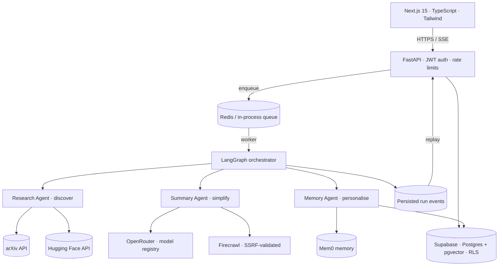
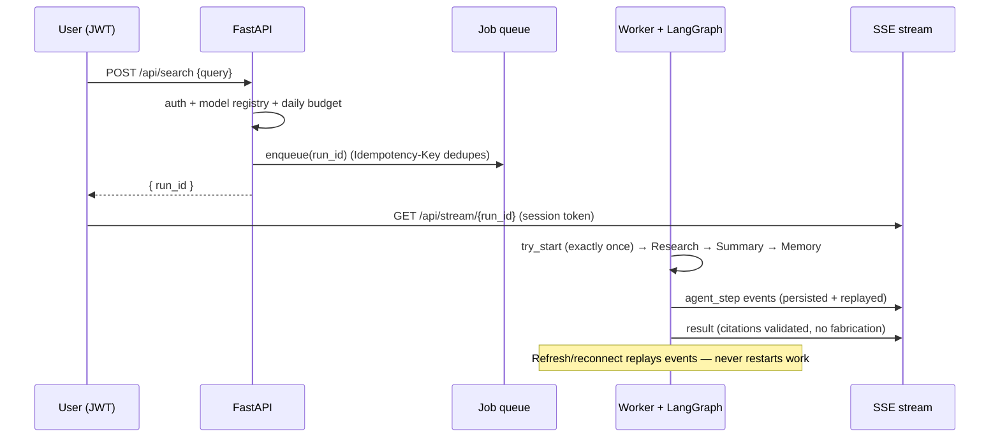

<div align="center">

# Zenith

### AI research intelligence and engineering workspace

[](https://github.com/mahirmlk/Zenith/actions/workflows/ci.yml)
[](backend/pyproject.toml)
[](frontend/package.json)
[](backend/main.py)
[](backend/agents/orchestrator.py)
[](supabase/schema.sql)
[](LICENSE)

[Features](#features) · [Architecture](#architecture) · [Quick start](#quick-start) · [API](#api) · [Security](#security) · [Roadmap](#roadmap)

</div>

## Overview

Zenith discovers papers from arXiv and Hugging Face Daily Papers, adds LLM summaries and citation graphs, and ranks papers against your personal memory profile. You can then organise them into research projects with grounded, cited answers.

Status: feature-complete local slices are under review; **not production-ready**. Staging migration/RLS checks, provider validation, recovery exercises, backup restore, Docker/remote CI, monitoring, and deployment remain unverified. Previously called "AI Paper Research Agent". The infra IDs (`ai-paper-agent-backend`) were kept for deployment compatibility.

## Features

| Area | What you get |
|---|---|
| Discovery | Multi-source fetch (arXiv + HF) with dedup, embedding backfill, hybrid BM25 + vector retrieval |
| Personalisation | Mem0 memory + pgvector similarity rank papers for you |
| Streaming | SSE with start-once durable runs, event replay, reconnect-safe, cancel |
| Citation graph | Cached Semantic Scholar edges, deterministic layout |
| Projects | CRUD, notes, sources, members (owner/editor/viewer), soft-delete |
| Research evidence | Task routing, comparison rows, abstaining answers, and a bounded project evidence map; no multi-paper synthesis |
| Paper-to-code | Evidence-backed abstract-level brief + Markdown export; arbitrary execution is always disabled |
| Monitoring | Watchlists (daily/weekly) + in-app notifications |
| Guardrails | Deny-by-default tool policy, backend approvals, citation validation, SSRF defence |
| Security | JWT allowlist + iss/aud, RLS migrations, ownership on every endpoint, rate limits + daily budget |

## Tech stack

<div align="center">

| Layer | Technologies |
|---|---|
| Frontend |    |
| Backend |    |
| AI |   |
| Data |    |
| Infra |   |

</div>

## Architecture

Four layers. The boundaries are enforced in code.



### Request flow (search to stream)



## Quick start

Prerequisites: Node 20, Python 3.12+, Docker (optional).

```bash
git clone https://github.com/mahirmlk/Zenith.git && cd Zenith
cp .env.example .env            # fill keys (see table below)
cp frontend/.env.local.example frontend/.env.local

# Backend
cd backend && pip install -e ".[dev]" && uvicorn main:app --reload --port 8000

# Frontend (new terminal)
cd frontend && npm ci && npm run dev   # http://localhost:3000
```

Full stack with Docker: `docker compose up --build` (frontend :3000, backend :8000, redis :6379).

### Environment variables

| Variable | Required | Purpose |
|---|---|---|
| `OPENROUTER_API_KEY` | Yes (LLM) | Primary LLM routing |
| `SUPABASE_URL` / `SUPABASE_SERVICE_ROLE_KEY` | Yes | DB + vector store |
| `SUPABASE_JWT_SECRET` | Legacy only | HS256 fallback (new projects use JWKS) |
| `FIRECRAWL_API_KEY` | Optional | Full-text crawling |
| `MEM0_API_KEY` | Optional | User memory |
| `REDIS_URL` | Prod | Shared queue + rate limits |
| `ADMIN_API_KEY` | Scheduler | `POST /api/internal/ingest` |
| `SANDBOX_ENABLED` | No (default `false`) | Paper-code execution |
| `MAX_SEARCHES_PER_DAY_PER_USER` | No (default `100`) | Spend budget |

Before production, apply [migrations](docs/MIGRATIONS_RUNBOOK.md) `0001-0009` to staging and verify RLS.

## API

| Endpoint | Auth | Purpose |
|---|---|---|
| `POST /api/search` | JWT | Create run (idempotent) |
| `GET /api/stream/{run_id}` | SSE token | Stream agent steps + result (replay) |
| `GET /api/runs/{id}` · `/events` · `POST /cancel` | JWT (owner) | Run status / replay / cancel |
| `GET /api/papers` · `/saved` · `/{id}` · `POST /{id}/save` | JWT | Papers + personal library |
| `GET /api/graph/{id}` | JWT | Citation graph (cached) |
| `POST /api/retrieval/search` | JWT | Hybrid (BM25 + vector), project-scoped |
| `POST /api/research/{plan,compare,answer,evidence-map}` | JWT | Task routing and bounded extractive research evidence; no synthesis |
| `GET /api/implementations/{id}/{plan,export}` | JWT | Paper-to-code plan (no execution) |
| `/api/projects` · `/notes` · `/members` | JWT (owner/member) | Research workspace |
| `/api/watchlists` · `/notifications` | JWT | Monitoring + in-app alerts |
| `GET /api/account/export` · `DELETE /api/account` | JWT | GDPR export / deletion |
| `GET /api/models` | Public | Model registry |
| `GET /api/health` · `/api/ready` | Public | Liveness / readiness |

Full contracts: [docs/API.md](docs/API.md).

## Project structure

```
Zenith/
├── frontend/          Next.js 15 (App Router) · app/ · components/ · lib/
├── backend/
│   ├── agents/        LangGraph orchestrator + research/summary/memory
│   ├── routers/       papers · search · stream · runs · projects · research …
│   ├── services/      llm_router (registry) · retrieval · job_queue · ssrf …
│   ├── security/      authorization · policies · input/output validation
│   ├── guardrails/    pipeline · action approvals
│   └── tests/         pytest (security · guardrails · retrieval · research)
├── supabase/migrations/  0001–0005 (RLS, projects, watchlists, notifications)
├── evals/             deterministic eval harness (CI smoke)
└── docs/              API · architecture · security · runbooks · STATUS
```

## Security

JWT verification allows ES256/RS256/EdDSA, plus HS256 for legacy tokens. Issuer and audience are checked, JWKS rotation refetches keys, and `service_role` tokens are rejected as user sessions.

Isolation comes from RLS on all 13 tables and server-side ownership checks on every endpoint. Ownerless runs are inaccessible.

Guardrails run in trusted Python code: a tool allowlist, backend-recorded approvals for high-risk actions, and rejection of fabricated citations.

SSRF defence validates scheme and IP before every server-side fetch. PWC repo URLs are host-allowlisted.

Spend is capped per user per day, with rate limits on expensive endpoints and a model registry so callers cannot pass arbitrary model IDs.

Client errors are generic (no `str(e)` leaks), security headers are set, and Langfuse/Sentry redact sensitive values.

Threat model and test plan: [docs/security/](docs/security/THREAT_MODEL.md).

## Testing and CI

```bash
cd backend && pytest            # 78 passed · 5 env-dependent (need OPENAI/Supabase)
cd frontend && npm run typecheck && npm test
python evals/runners/run_evals.py   # deterministic eval smoke (CI gate)
```

GitHub Actions run on every PR/push: lint, typecheck, tests, eval smoke, Docker build.

## Roadmap

| Phase | Status |
|---|---|
| Security, guardrails, durable runs, evals | Shipped |
| Research workspaces, hybrid retrieval, deep research | Shipped |
| Evidence map and paper-to-code plan/export | Implemented locally; evaluation and staging verification remain |
| Multi-paper synthesis, secure paper-code execution, invitation UX, integrations | Not implemented |
| Staging release gates and production deployment | Blocked on live infrastructure and remote CI evidence |

Live status matrix: [docs/STATUS.md](docs/STATUS.md). Full plan: [update.md](update.md).

## Contributing

See [CONTRIBUTING.md](CONTRIBUTING.md) and [docs/DEVELOPER_GUIDE.md](docs/DEVELOPER_GUIDE.md). One branch per phase, tests and docs in the same PR, never edit `main` directly, keep merged branches.

## License

[MIT](LICENSE) © Zenith contributors.
