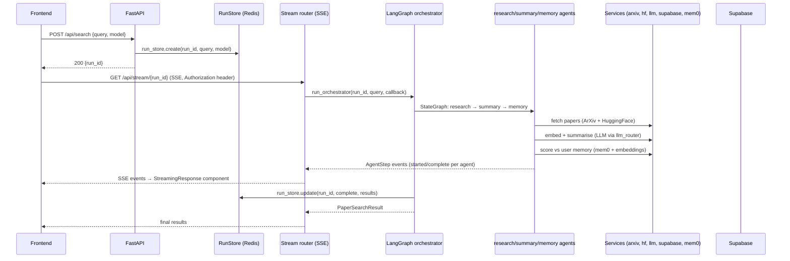
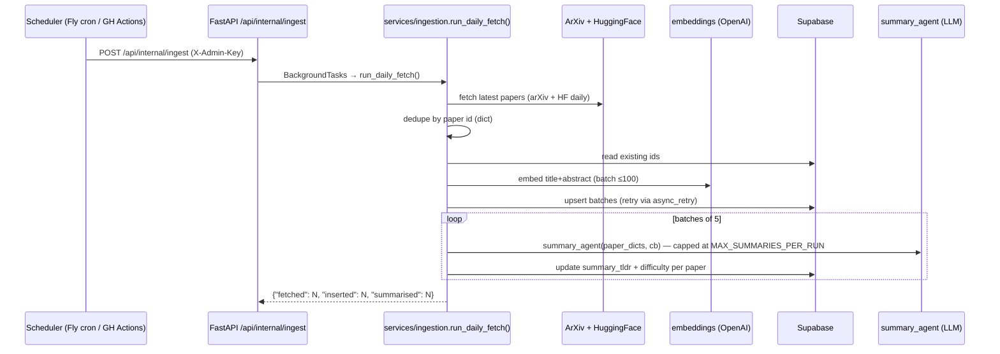
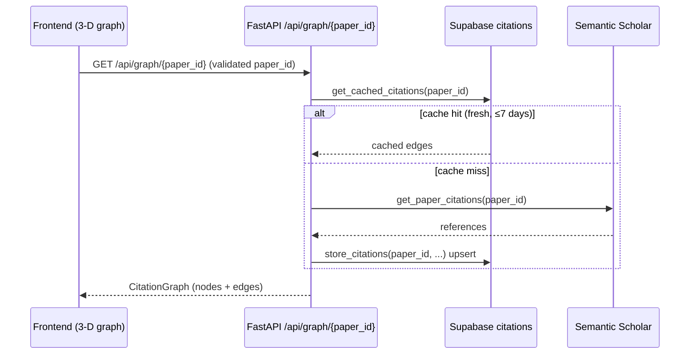
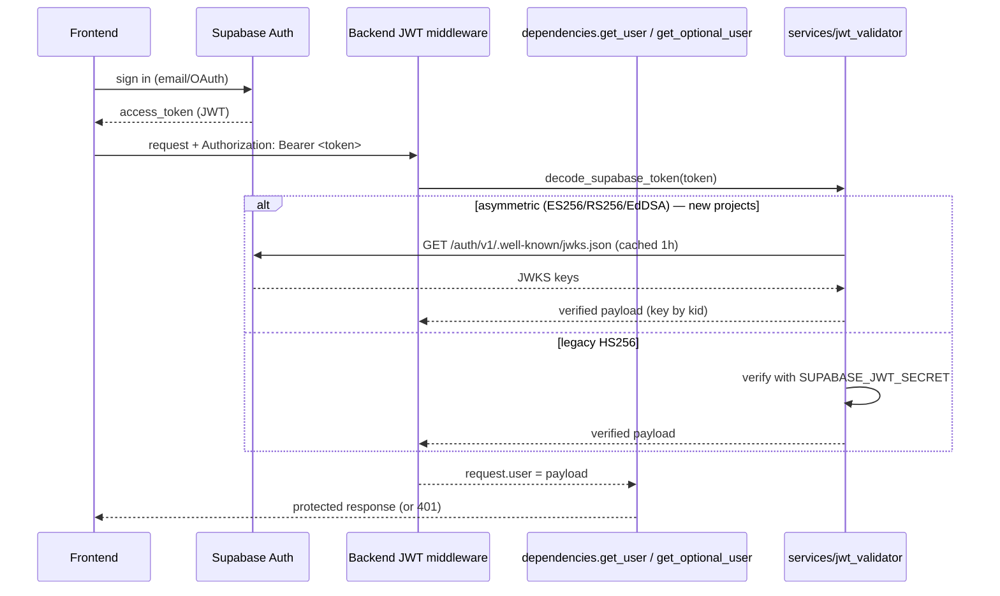
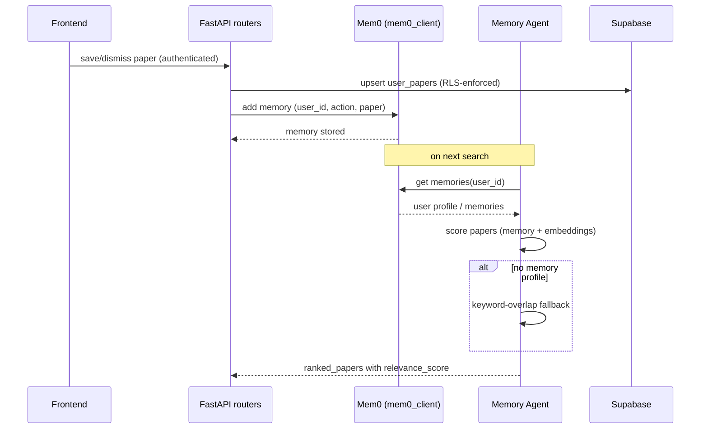

# Data Flows

> End-to-end walkthroughs of every major data path in the system, from HTTP request to external service and back.

---

## Table of Contents

- [Flow map](#flow-map)
- [Flow 1 — User search (interactive)](#flow-1--user-search-interactive)
- [Flow 2 — Daily ingestion (scheduled)](#flow-2--daily-ingestion-scheduled)
- [Flow 3 — Citation graph](#flow-3--citation-graph)
- [Flow 4 — Authentication & token validation](#flow-4--authentication--token-validation)
- [Flow 5 — Memory write-back & personalisation](#flow-5--memory-write-back--personalisation)
- [Cross-cutting concerns](#cross-cutting-concerns)

---

## Flow map

```
                ┌────────────────────────────────────────────────────────┐
                │                        FRONTEND                        │
                │   Next.js (feed, graph, paper detail, settings, auth)  │
                └───────────────┬────────────────────────┬───────────────┘
                                │ HTTP + Bearer JWT      │ SSE (stream)
                                ▼                        ▼
                ┌────────────────────────────────────────────────────────┐
                │                        BACKEND                         │
                │  FastAPI ── middleware: JWT, rate-limit, timing        │
                │  routers ── health, auth, papers, search, stream,      │
                │             graph, prefs, pwc, internal                │
                │  agents  ── research → summary → memory (LangGraph)    │
                │  services── arxiv, hf, firecrawl, s2, supabase, ...    │
                └──────┬──────────┬──────────┬──────────────┬────────────┘
                       │          │          │              │
                       ▼          ▼          ▼              ▼
                   Supabase   Redis     OpenRouter/     ArXiv / HF / S2 /
                  (DB+Auth)  (state/      LLM fallbacks  Firecrawl / PwC
                              limits)
```

Layer boundaries are enforced per [ADR-001](./adr/0001-four-layer-architecture.md): routers → agents → services → external APIs, never backwards or crosswise.

---

## Flow 1 — User search (interactive)

This is the primary interactive path: the user types a query, sees live agent progress via SSE, and gets a ranked, personalised list of papers.



Key files:

- `frontend/app/feed/page.tsx`, `frontend/components/StreamingResponse.tsx`
- `backend/routers/search.py` — creates the run
- `backend/routers/stream.py` — SSE endpoint (token in header, not URL — see [.plans/007](../.plans/007-fix-sse-jwt-exposure.md))
- `backend/agents/orchestrator.py` — the LangGraph pipeline
- `backend/services/run_store.py` — run state (Redis-backed)

Details:

- **Step 1 — kick off:** `POST /api/search` only stores a run; it returns immediately with `{run_id}`. All heavy work happens async.
- **Step 2 — stream:** the frontend opens `GET /api/stream/{run_id}`. `run_orchestrator` registers a callback that emits `AgentStep` events as each agent starts/completes/errors, and `stream.py` fans them out over SSE.
- **Step 3 — orchestration:** the graph runs `research → summary → memory` ([ADR-001](./adr/0001-four-layer-architecture.md)). Each node catches its own errors and emits an `error` step rather than crashing the run; failures degrade to the previous stage's output (e.g., raw papers if summarisation fails).
- **Step 4 — result:** the final state is projected into `Paper` objects, persisted to the run store, and returned. `max_summaries` is not capped here because interactive result sets are small ([ADR-008](./adr/0008-summary-cost-cap.md)).

---

## Flow 2 — Daily ingestion (scheduled)

Runs once daily to harvest new papers, embed, store, and summarise them. Triggered either by a Fly.io scheduled machine or GitHub Actions cron; both hit the internal admin endpoint.



Key files:

- `.github/workflows/daily_fetch.yml` and `backend/fly.toml` — schedulers
- `backend/routers/internal.py` — admin-key-protected endpoint
- `backend/services/ingestion.py` — the pipeline
- `backend/services/retry.py` — retries on Supabase writes and embeddings
- `backend/agents/summary_agent.py` — bounded summarisation ([ADR-008](./adr/0008-summary-cost-cap.md))

Details:

- **Auth:** the endpoint returns `401` without a valid `X-Admin-Key` (`ADMIN_API_KEY`), and `503` if `ADMIN_API_KEY` is unset. The work runs on `BackgroundTasks`, so the scheduler gets `200` immediately ([ADR-004](./adr/0004-daily-ingestion-scheduler.md)).
- **Resilience:** if embeddings fail, papers are still inserted with `embedding = NULL` (vector search degrades); if HuggingFace fails, only ArXiv is used; if summarisation fails, the run completes with `summarised` lower than `inserted`. Supabase writes are wrapped in `async_retry`.
- **Cost guard:** only `MAX_SUMMARIES_PER_RUN` (default 20) papers get LLM summaries; the rest get an abstract-based preview. A 2-second sleep between summary batches prevents LLM rate-limit bursts.

---

## Flow 3 — Citation graph

The 3-D graph endpoint reads from the Supabase-backed cache first and only calls Semantic Scholar on a miss.



Key files:

- `frontend/app/graph/page.tsx`, `frontend/components/CitationGraph.tsx`
- `backend/routers/graph.py` — cache-first lookup, paper_id validation (see [.plans/008](../.plans/008-fix-downgraded-findings.md))
- `backend/services/citation_cache.py` — 7-day TTL cache
- `backend/services/semantic_scholar.py` — S2 client

Details:

- **Validation:** `paper_id` is checked against `^[a-zA-Z0-9\-._:/]+$` before use.
- **No fabricated data:** if S2 is unavailable and the cache is cold, the endpoint returns an **empty graph** — never mock data — so the UI shows an empty state rather than lies ([ADR-007](./adr/0007-citation-cache.md)).
- **Paper detail code links** are a parallel path: `backend/routers/pwc.py` → `services/papers_with_code.py` (Papers With Code API) and, for full text, `services/firecrawl.py` (`crawl_paper_cached`, backed by the `crawled_content` table).

---

## Flow 4 — Authentication & token validation

Supabase issues JWTs; the backend validates them on every request except `/api/health`.



Key files:

- `backend/middleware/` (JWT middleware), `backend/dependencies.py`
- `backend/services/jwt_validator.py` — ES256 JWKS + HS256 fallback ([ADR-003](./adr/0003-jwt-validation.md))
- `backend/routers/auth.py` — `POST /api/auth/token` (exchange/refresh)

Details:

- JWKS is fetched lazily and cached in memory for 1 hour; `invalidate_jwks_cache()` exists for tests.
- `verify_aud` is disabled to match Supabase's audience handling; `kid` selects the signing key.
- Failures are fail-closed: any invalid header/signature/key yields `401`.

---

## Flow 5 — Memory write-back & personalisation

User actions (save/dismiss) and search behaviour feed Mem0, which the Memory Agent reads to rank papers.



Key files:

- `backend/routers/papers.py`, `backend/routers/prefs.py`
- `backend/services/mem0_client.py`
- `backend/agents/memory_agent.py`
- `frontend/store/useAppStore.ts`, `frontend/lib/api.ts`

Details:

- The `user_id` from the validated JWT keys both Mem0 and saved-paper rows.
- Ranking is embedding-similarity first, keyword overlap as a fallback when no profile exists (see [MEMORY.md](../MEMORY.md)).

---

## Cross-cutting concerns

| Concern | Where it's handled | Notes |
|---------|--------------------|-------|
| **Retries** | `services/retry.py` | Exponential backoff; used by embeddings, ingestion writes, summary agent, Firecrawl ([ADR-005](./adr/0005-retry-strategy.md)) |
| **Rate limiting** | `middleware/rate_limit.py` | Redis-backed via slowapi; per-IP; search 10/min, stream 20/min, default 60/min ([ADR-006](./adr/0006-rate-limiting.md)) |
| **Response timing** | `middleware/timing.py` | `X-Response-Time` header; latency logged |
| **Tracing** | `services/observability.py` | Langfuse callback attached to orchestrator `ainvoke` ([ADR-009](./adr/0009-observability.md)) |
| **Error tracking** | `services/observability.py` | Sentry init in app lifespan, `APP_ENV` tagging |
| **Structured logging** | `logging_config.py` | Timestamped, level-tagged logs for all services |
| **Caching** | `citation_cache.py`, `firecrawl.py` | Supabase-backed citation edges + crawled content, 7-day TTL ([ADR-007](./adr/0007-citation-cache.md)) |
